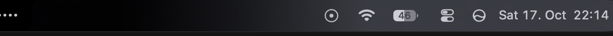
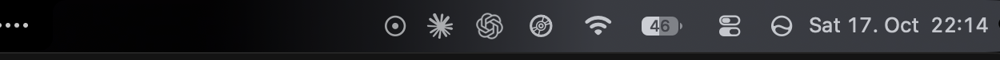
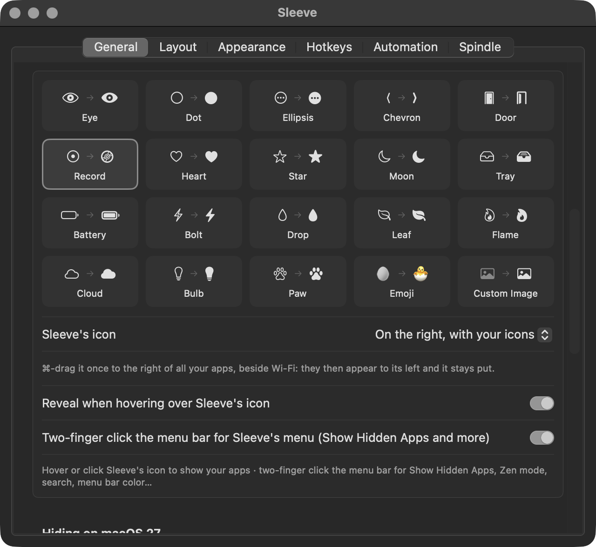
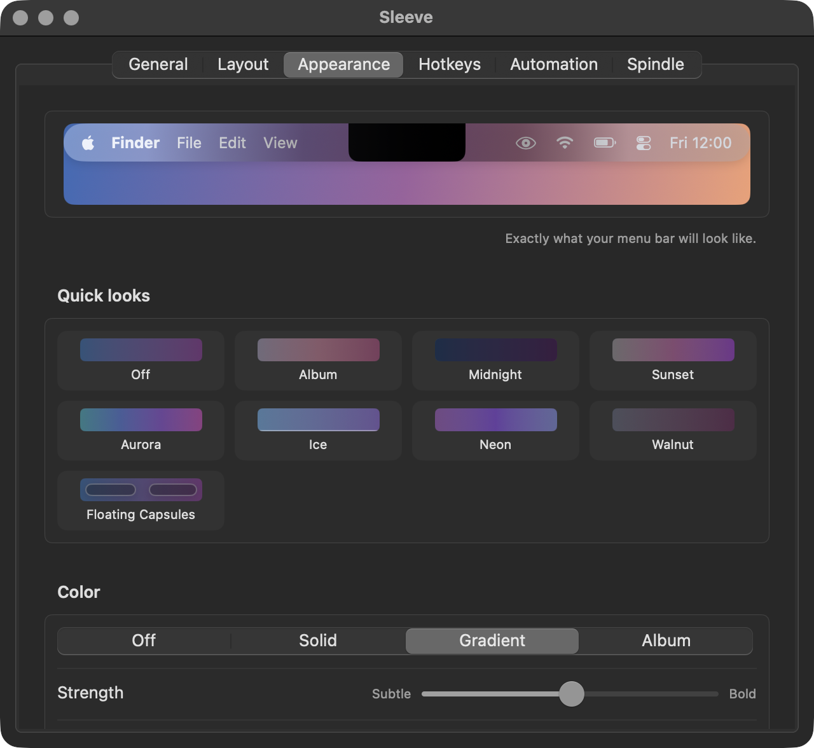

<p align="center">
  
  &nbsp;&nbsp;&nbsp;
  
</p>

<h1 align="center">Spindle &amp; Sleeve</h1>

<p align="center">
  <b>A retro turntable that lives in your MacBook's notch — and a menu bar manager that keeps everything around it tidy.</b><br>
  Two native macOS apps, written from scratch in Swift, that work on their own and in sync.
</p>

<p align="center">
  <a href="https://github.com/zaineldinbarakat-droid/spindle/releases/latest"></a>
  
  
  
  
  <a href="LICENSE"></a>
</p>

<p align="center">
  <a href="#download">Download</a> ·
  <a href="#spindle">Spindle</a> ·
  <a href="#sleeve">Sleeve</a> ·
  <a href="#under-the-hood">Under the hood</a> ·
  <a href="#build-from-source">Build</a> ·
  <a href="CHANGELOG.md">Changelog</a>
</p>

<p align="center">
  
</p>

---

## Highlights

- 🎛️ **A turntable in the notch.** Hover the notch and a panel springs out of it, Dynamic-Island style: album art, a spinning record, a tonearm you can drag to scrub, and transport controls. Works with **Spotify** and **Apple Music**.
- ⏱️ **A built-in focus timer** ("Lock In"), with 25 / 5 and 50 / 10 presets, right in the notch and on a full-screen turntable scene.
- 🧹 **Sleeve hides your menu bar clutter** until you hover the bar — Ice-style — using macOS 27's own native hiding, with per-app *Always / On Hover / Hidden* placement.
- 🎨 **Menu bar colours and gradients**, 20 icon styles (including any emoji), Zen mode, search, hotkeys and automation rules.
- 🪶 **Featherweight.** Idle, each app uses about **0.1 % CPU** and **15–30 MB** of memory; animations run on Core Animation, not the CPU.
- 🔒 **Private by design.** No accounts, no tracking, no network calls except fetching cover art and checking this repo for updates.

## Download

| App | What it is | Download |
| --- | --- | --- |
|  **Spindle** | The notch music player and focus timer | [**Spindle.zip**](https://github.com/zaineldinbarakat-droid/spindle/releases/latest/download/Spindle.zip) |
|  **Sleeve** | The menu bar manager | [**Sleeve.zip**](https://github.com/zaineldinbarakat-droid/spindle/releases/latest/download/Sleeve.zip) |

**Requires** a Mac with Apple Silicon and macOS 14 Sonoma or later. Sleeve's native hiding needs macOS 27; Liquid Glass needs macOS 26.

### Installing

1. Unzip and drag the app into **Applications** (Sleeve must live there to hide icons on macOS 27).
2. The apps aren't notarized by Apple yet, so the first launch is blocked. Open **System Settings → Privacy & Security**, scroll down and click **Open Anyway** — or run once in Terminal:
   ```bash
   xattr -dr com.apple.quarantine /Applications/Spindle.app /Applications/Sleeve.app
   ```
3. Grant what each app asks for:
   - **Spindle** — *Automation* access to Music and/or Spotify (that's how it reads and controls playback).
   - **Sleeve** — *Accessibility* (to find and arrange menu bar icons).

Both apps **update themselves**: they check this repository once a day and offer *Install & Relaunch*.

---

## Spindle

<p align="center">
  
</p>

- **Notch turntable.** The panel grows out of the hardware notch with a spring, like the Dynamic Island, and tucks back the moment you move away. Show the song as a **spinning vinyl record** (cover art pressed into the label, tonearm tracking the playhead) or as the **album cover**.
- **Drag the tonearm to scrub.** The arm's angle maps exactly to the playhead and back, so you can drop the needle anywhere in the song.
- **One click to the source.** Click the cover, the record or the title and Spotify or Music comes to the front.
- **Closed, it's a quiet pill** around the notch: the cover on the left, a *now playing* indicator on the right — bars, a wave or a pulse, in the album's colour, white or any colour, with adjustable brightness and glow.

  

- **Three looks.** *Black* (seamless with the hardware), *Song Color* (the panel takes on the album's colour) and **Liquid Glass** with a Clarity slider — from genuinely see-through glass that bends the light at its edges to fully frosted.

  

- **Focus timer — "Lock In".** Pomodoro cycles with one-tap 25 / 5 ↔ 50 / 10, long breaks, a countdown in the closed notch, notifications, and optional pause-the-music-on-breaks.
- **Desktop widgets and a full-screen turntable.** Live *Record* and *Turntable* widgets on the desktop, an optional animated wallpaper, and a full-screen scene (above) with the timer beside the song.

## Sleeve

<table>
  <tr>
    <td align="center"><b>Apps tucked away</b><br></td>
  </tr>
  <tr>
    <td align="center"><b>Hover the bar — they're back</b><br></td>
  </tr>
</table>

- **Hide everything until you hover.** The bar shows only Sleeve and Apple's icons; hover it and your apps appear in place, move away and they're gone — instantly, with no delay. Clicking never hides anything, and an open menu or popover keeps things in place.
- **Per-app placement.** Each app is *Always* shown, shown *On Hover*, or *Hidden* — tucked into a hidden section (with anything macOS couldn't fit) that opens from a two-finger click on the bar.
- **Menu bar colour, the Ice way.** Solid colours, gradients you build by hand, palettes, an *Album* look that follows the song in Spindle, shapes, shadows and borders — with a live preview.
- **20 icon styles** that go from empty to full as your apps appear — eye, heart, moon, tray, battery, … or **any emoji** (grey while hidden, full colour while showing).
- **And more:** adjustable icon spacing, menu bar search (⌃⌥⌘S), Zen mode that clears the whole bar, rebindable hotkeys, and automation rules (battery, Wi-Fi network, Focus, or a script).

<p align="center">
  
  
</p>

---

## Under the hood

Some of the more interesting engineering problems, and how they were solved:

**Reading and controlling music without any account.** Spindle talks to the *locally running* Music and Spotify apps over **Apple Events** (compiled AppleScript on a serial queue, with Automation permission handled explicitly). The private `MediaRemote` framework was ruled out: Apple restricted it to Apple-signed binaries in macOS 15.4, and it can't seek another app's playhead — Apple Events can, which is what makes drag-to-scrub possible. Updates are **event-driven** from the apps' own distributed notifications, with a light re-sync poll; the playhead in between is interpolated from a monotonic clock. Two portability bugs were caught early: AppleScript returns numbers in the *system locale* (`42,5` on some Macs), and `st`/`nd`/`rd`/`th` are reserved words.

**Hiding menu bar icons on macOS 27.** Classic menu bar managers push icons off-screen with a 10 000 pt divider. macOS 27 moved status item layout into a system process (MenuBarAgent) that caps item width and ignores synthesized ⌘-drags, so that trick no longer works. Sleeve uses the private `MenuBarClientCore` restriction behind macOS's exam mode: it hands MenuBarAgent an allow-list and the system removes and reflows everything else. The bridge is a small Objective-C target that resolves everything at runtime, catches exceptions and **fails open** — if the API is missing, Sleeve falls back to covering icons instead of leaving them hidden.

**Seeing every mouse move.** NSEvent's global monitors only receive events meant for *other* apps, so hover silently died whenever Sleeve itself had focus. Sleeve uses a passive, listen-only **CGEventTap** instead, which sees everything without ever delaying input.

**Performance as a feature.** Profiling showed Spindle's tiny animated indicator costing ~35 % of a CPU core: SwiftUI was re-rendering it every frame at 120 Hz. It — and the spinning record — are now **Core Animation** loops handed to the window server once (keyframes sampled from the original sine motion, with frequencies nudged so the loops are seamless). Sleeve's menu bar scan touched 124 processes every 3 s; it now does a full scan only when apps launch or quit and otherwise re-reads the ~10 apps that own icons.

| Idle, measured | Before | After |
| --- | --- | --- |
| Spindle | 32–39 % CPU · 276 MB | **0.0–0.2 % CPU · 30 MB** |
| Sleeve | ~2 % CPU · 50 MB | **0.0–0.1 % CPU · 15 MB** |

**Truly clear Liquid Glass.** `NSGlassEffectView`'s public styles, placed over *other apps'* windows, render as a heavy frost — even `.clear`. Testing its configurations found the lensing variant Apple uses for clear glass: what's behind stays sharp and the edges refract it. It's applied behind a `responds(to:)` guard and falls back to the public style.

**Two apps, one notch.** Spindle and Sleeve coordinate over distributed notifications (`SpindleSync`): Spindle publishes the area it occupies so Sleeve's hover zone and colouring stay out of it, only one dropdown is open at a time, Zen mode hides both, and Sleeve's *Album* tint follows the song.

**Self-updating.** Each app checks `updates/latest.json` in this repo, downloads its zip, verifies the bundle identifier and code signature, swaps itself atomically and relaunches. Builds are signed with a designated requirement pinned to the bundle identifier, so permissions survive updates.

## Build from source

Requires **Xcode** (the SwiftUI macros ship only inside Xcode, so the Command Line Tools alone aren't enough).

```bash
git clone https://github.com/zaineldinbarakat-droid/spindle.git
cd spindle
sudo xcode-select -s /Applications/Xcode.app/Contents/Developer
./install.sh          # builds both apps and installs them in /Applications
```

`build.sh` assembles the `.app` bundles, `release.sh <version> "<notes>"` packages an update, and both icons are drawn in code by `Packaging/make-icons.swift`.

### Project structure

```
Sources/
├── Spindle/            the notch player (~5.4k lines)
│   ├── Player/         Apple Events bridge, Spotify & Music providers, artwork + accent colour
│   ├── Notch/          notch geometry, the panel, hover logic, backgrounds (incl. Liquid Glass)
│   ├── Vinyl/          record, tonearm geometry (exact angle ↔ progress inverse), turntable
│   ├── Focus/          the Pomodoro timer and its views
│   ├── Desktop/        widgets, wallpaper and the full-screen scene
│   └── UI/             indicator, transport, progress, settings
├── Sleeve/             the menu bar manager (~5.7k lines)
│   ├── Core/           AX scanner, sections, native hiding, event tap, gestures, hotkeys, automation
│   ├── Appearance/     the menu bar style model and overlay
│   └── UI/             settings, hidden-section drawer, search, Zen mode, emoji icons
├── SpindleSync/        what the two apps share: the sync channel and the updater
└── MenuBarVisibility/  Objective-C bridge to macOS 27's menu bar restriction
```

## Privacy

Spindle has no account, no API key and makes no network request except fetching Spotify's cover art and checking this repository for updates. Nothing about what you listen to leaves your Mac. Sleeve makes no network requests apart from the update check.

## Limitations

- **Not notarized yet** — see [Installing](#installing) for the one-time step. A Developer ID would remove it.
- **Spotify and Apple Music only.** YouTube, Tidal and others expose no scripting interface.
- The *now playing* indicator is decorative motion, not a real spectrum analyser (that would need a system audio tap).
- Sleeve can't choose where macOS puts its own icon; a one-time ⌘-drag beside Wi-Fi keeps it on the right.

## License

[MIT](LICENSE) © 2026 Zaineldein Barakat

<p align="center"><sub>Designed and built by <a href="https://github.com/zaineldinbarakat-droid">Zaineldein Barakat</a>.</sub></p>
