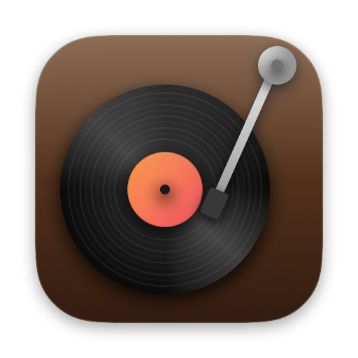
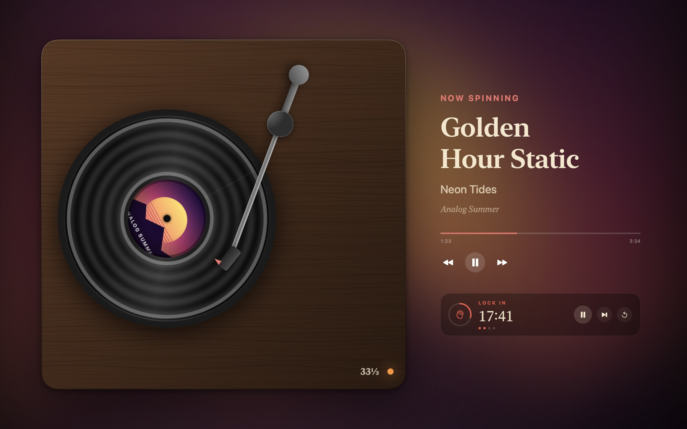

<p align="center">
  
</p>

<h1 align="center">Spindle</h1>

<p align="center">
  <b>A retro turntable that lives in your MacBook's notch.</b><br>
  A native macOS music player for Spotify and Apple Music, with a built-in focus timer.
</p>

<p align="center">
  🤝 <b>Made to be compatible with <a href="https://github.com/zaineldinbarakat-droid/sleeve">Sleeve</a></b>, my menu bar manager — use them together, or each on its own.
</p>

<p align="center">
  <a href="https://github.com/zaineldinbarakat-droid/spindle/releases/latest"></a>
  
  
  
  
  <a href="LICENSE"></a>
  <a href="https://github.com/zaineldinbarakat-droid/sleeve"></a>
</p>

<p align="center">
  <a href="https://github.com/zaineldinbarakat-droid/spindle/releases/latest/download/Spindle.zip"><b>⬇︎ Download Spindle</b></a>
  &nbsp;·&nbsp;
  <a href="#made-to-be-compatible-with-sleeve">Works with Sleeve</a>
  &nbsp;·&nbsp;
  <a href="#under-the-hood">Under the hood</a>
</p>

<details>
<summary><b>🇩🇪 Auf Deutsch lesen</b></summary>

### Spindle – ein Retro-Plattenspieler in der MacBook-Notch

Spindle ist ein nativer Musikplayer für macOS, der in der Notch deines MacBooks lebt – für **Spotify** und **Apple Music**, mit eingebautem **Fokus-Timer**.

- **Plattenspieler in der Notch:** Fährst du mit der Maus über die Notch, klappt ein Panel heraus – mit drehender Schallplatte (das Albumcover auf dem Label) oder dem Albumcover, Titel und Steuerung.
- **Tonarm zum Spulen:** Zieh den Tonarm an jede beliebige Stelle im Song.
- **Drei Looks:** *Schwarz* (nahtlos mit der Notch), *Songfarbe* und **Liquid Glass** – von klar bis milchig.
- **Fokus-Timer „Lock In“:** Pomodoro mit 25/5 oder 50/10 Minuten, direkt in der Notch und im Vollbild-Plattenspieler.
- **Leichtgewichtig:** Im Leerlauf nur ca. 0,1 % CPU und 30 MB Arbeitsspeicher.
- **Kompatibel mit [Sleeve](https://github.com/zaineldinbarakat-droid/sleeve):** Beide Apps sind aufeinander abgestimmt – sie teilen sich den oberen Bildschirmrand, öffnen nie gleichzeitig, und die Menüleiste kann die Farbe des laufenden Songs übernehmen. Jede App funktioniert aber auch allein.

**Installation:** [Spindle.zip herunterladen](https://github.com/zaineldinbarakat-droid/spindle/releases/latest/download/Spindle.zip), entpacken und in **Programme** ziehen. Beim ersten Start unter **Systemeinstellungen → Datenschutz & Sicherheit** auf **Trotzdem öffnen** klicken und Spindle die Steuerung von Musik bzw. Spotify erlauben. Voraussetzung: Mac mit Apple-Chip und macOS 14 oder neuer. Spindle aktualisiert sich selbst.

</details>

<p align="center">
  
</p>

## Features

<p align="center">
  
</p>

- **A turntable in the notch.** Hover the notch and a panel springs out of it, Dynamic-Island style, and tucks back the moment you move away. Show the song as a **spinning vinyl record** — cover art pressed into the label, a tonearm that tracks the playhead — or as the **album cover**.
- **Drag the tonearm to scrub.** The arm's angle maps exactly to the playhead and back, so you can drop the needle anywhere in the song. A progress bar and play / pause / skip sit beside it.
- **One click to the source.** Click the cover, the record or the title and Spotify or Music comes to the front.
- **Closed, it's a quiet pill.** The cover on the left of the notch, a *now playing* indicator on the right — bars, a wave or a pulse, in the album's colour, white or any colour, with adjustable brightness and glow.

  

- **Three looks.** *Black* (seamless with the hardware notch), *Song Color* (the panel takes on the album's colour) and **Liquid Glass** with a Clarity slider — from genuinely see-through glass that bends the light at its edges to fully frosted.

  

- **Focus timer — "Lock In".** Pomodoro cycles with a one-tap 25 / 5 ↔ 50 / 10 switch, long breaks, a countdown in the closed notch, notifications, and optional pause-the-music-on-breaks.
- **Desktop widgets and a full-screen turntable.** Live *Record* and *Turntable* widgets, an optional animated wallpaper, and a full-screen scene (above) with the timer beside the song.
- **Featherweight.** Idle, about **0.1 % CPU and 30 MB**; animations run on Core Animation, so playing music costs Spindle next to nothing.
- **Private by design.** No account, no API key, no tracking.

## Made to be compatible with Sleeve

Spindle and [**Sleeve**](https://github.com/zaineldinbarakat-droid/sleeve) — a menu bar manager that hides your menu bar apps until you hover the bar — were designed as a pair:

- **They share the top of the screen politely.** Spindle tells Sleeve exactly where its notch pill and panel are, and Sleeve keeps its hover zone and menu bar colouring out of that area — so hovering the notch opens Spindle, never your hidden menu bar apps.
- **One dropdown at a time.** Opening Spindle's panel closes Sleeve's, and the other way round.
- **Zen mode covers both.** Sleeve's Zen mode can hide Spindle's pill too, for a completely clean top edge.
- **The menu bar can match the music.** Sleeve's *Album* colour tints the menu bar with the song playing in Spindle.
- **Tidy icons.** When Spindle starts, it lets Sleeve know first, so its menu bar icon lands next to your other apps.

Each app works fully on its own; together they feel like one. → [**Get Sleeve**](https://github.com/zaineldinbarakat-droid/sleeve/releases/latest/download/Sleeve.zip)

## Install

1. [Download **Spindle.zip**](https://github.com/zaineldinbarakat-droid/spindle/releases/latest/download/Spindle.zip), unzip it and drag **Spindle** into **Applications**.
2. Spindle isn't notarized by Apple yet, so the first launch is blocked: open **System Settings → Privacy & Security** and click **Open Anyway** — or run once in Terminal:
   ```bash
   xattr -dr com.apple.quarantine /Applications/Spindle.app
   ```
3. Allow Spindle to control **Music** and/or **Spotify** when asked — that's how it reads and controls playback.

**Requires** a Mac with Apple Silicon and macOS 14 Sonoma or later (Liquid Glass needs macOS 26). Spindle **updates itself** from this repository: it checks once a day and offers *Install & Relaunch*.

## Under the hood

**Reading and controlling music without any account.** Spindle talks to the *locally running* Music and Spotify apps over **Apple Events** — compiled AppleScript on a serial queue, with Automation permission handled explicitly. The private `MediaRemote` framework was ruled out: Apple restricted it to Apple-signed binaries in macOS 15.4, and it can't seek another app's playhead. Apple Events can, which is what makes drag-to-scrub possible. Updates are **event-driven** from the music apps' own distributed notifications, with a light re-sync poll, and the playhead in between is interpolated from a monotonic clock. Two portability bugs were caught early: AppleScript returns numbers in the *system locale* (`42,5` on some Macs), and `st` / `nd` / `rd` / `th` are reserved words.

**The notch.** Its exact size and position come from the screen's safe-area insets and auxiliary top areas. The panel is a borderless, non-activating window above the menu bar that never resizes — it's always the expanded size and click-through where nothing is drawn — so opening it is a pure spring animation with no window tearing.

**The tonearm.** Pivot geometry with an exact inverse between the arm's angle and the song's progress (unit-tested to a round-trip error of 1e-15), so dragging the arm seeks precisely.

**Performance as a feature.** Profiling showed the tiny animated indicator costing ~35 % of a CPU core: SwiftUI was re-rendering it every frame at 120 Hz. It — and the spinning record — are now **Core Animation** loops handed to the window server once, with keyframes sampled from the original sine motion and frequencies nudged so the loops are seamless.

| Idle, measured | Before | After |
| --- | --- | --- |
| CPU | 32–39 % | **0.0–0.2 %** |
| Memory | 276 MB | **30 MB** |

**Truly clear Liquid Glass.** `NSGlassEffectView`'s public styles, placed over *other apps'* windows, render as a heavy frost — even `.clear`. Testing its configurations found the lensing variant Apple uses for clear glass: what's behind stays sharp and the edges refract it. It's applied behind a `responds(to:)` guard and falls back to the public style.

**Self-updating.** Spindle checks `updates/latest.json` in this repository, downloads its zip, verifies the bundle identifier and code signature, swaps itself atomically and relaunches. Builds are signed with a designated requirement pinned to the bundle identifier, so permissions survive updates.

## Build from source

Requires **Xcode** (SwiftUI's macros ship only inside Xcode, so the Command Line Tools alone aren't enough).

```bash
git clone https://github.com/zaineldinbarakat-droid/spindle.git
cd spindle
./install.sh          # builds Spindle and installs it in /Applications
```

`build.sh` assembles the `.app`, `release.sh <version> "<notes>"` packages an update, and the icon is drawn in code by `Packaging/make-icons.swift`.

```
Sources/
├── Spindle/
│   ├── Player/      Apple Events bridge, Spotify & Music providers, artwork and accent colour
│   ├── Notch/       notch geometry, the panel, hover logic, backgrounds (incl. Liquid Glass)
│   ├── Vinyl/       record, tonearm geometry, turntable
│   ├── Focus/       the Pomodoro timer and its views
│   ├── Desktop/     widgets, wallpaper and the full-screen scene
│   └── UI/          indicator, transport, progress, settings
└── SpindleSync/     shared with Sleeve: the sync channel and the self-updater
```

## Limitations

- **Not notarized yet** — see [Install](#install) for the one-time step.
- **Spotify and Apple Music only.** YouTube, Tidal and others expose no scripting interface.
- The *now playing* indicator is decorative motion, not a real spectrum analyser (that would need a system audio tap).

See the [changelog](CHANGELOG.md) for the full history.

## License

[MIT](LICENSE) © 2026 Zaineldein Barakat

<p align="center"><sub>Designed and built by <a href="https://github.com/zaineldinbarakat-droid">Zaineldein Barakat</a> · also by me: <a href="https://github.com/zaineldinbarakat-droid/sleeve">Sleeve</a>, the menu bar manager made to work with Spindle.</sub></p>
